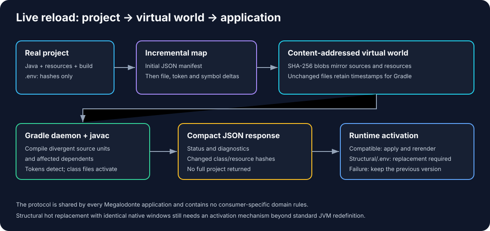

# Megalodonte Base

A lightweight JavaFX framework for building desktop applications with a **React-inspired architecture**, featuring routing, theming, components, and async utilities.

State, theme and scale types come from `megalodonte-core` through this library.
Publish core to Maven Local before publishing base. Bootstrap installs the JavaFX
scale and font adapters. Consumers built against earlier module layouts need recompilation.

---

## Features

- **Routing System** - Simple navigation between screens
- **Theme System** - Customizable colors, typography, spacing, borders, and radius
- **Component Architecture** - React-inspired component model
- **Async Utilities** - Easy async operations
- **Scope** - Lifecycle-bound cancellation for async work
- **Bootstrap Lifecycle** - Clean application startup
- **Development live reload** - Incremental shadow builds and in-place updates across managed desktop windows

## Live reload during development

With the updated Megalodonte CLI, core and base installed, run from a native
desktop project:

```sh
megalodonte dev --project .
```

Compatible method edits update the running JVM and rerender registered windows
while keeping screen instances and their state. Failed builds leave the app
running. Structural edits and dependency changes automatically restart the
application child, recreating windows and losing in-memory state. Use
`--no-restart-on-incompatible` to keep the previous generation active instead.
Read [the live reload guide](docs/LIVE_RELOAD.md) for supported projects, lifecycle,
subscription cleanup, rollback boundaries and validation commands. The
[compilation-world protocol](docs/COMPILATION_WORLD.md) explains project/token
deltas, content-addressed resources, compact responses and `.env` restarts.



---

## Experimental persistent native host

A separate messaging prototype keeps native windows in a permanent JavaFX host
while replacing Java worker processes. It uses an internal JSON protocol, not
JSONC authoring. It currently requires an explicit Java prototype API and does
not transparently support existing applications. The CLI opt-in is
`megalodonte dev --native-host --worker-main your.package.WorkerMain`.
See [design, API and validation status](docs/NATIVE_MESSAGING.md).

## Installation (Maven Local)

Use JDK 25. The included Gradle wrapper downloads Gradle 9.2.0. Publish the
matching `megalodonte-core:1.0.0-beta` artifact to Maven Local first; it is a
required API dependency. From this repository root, run:

```bash
./gradlew publishToMavenLocal
```

The GitHub Pages workflow checks out `megalodonte-core` and publishes it to the
runner's Maven Local before generating Javadoc; it does not depend on artifacts
already present on the runner.

Add this library to your project:

```gradle
repositories {
    mavenLocal()
    mavenCentral()
}

dependencies {
    implementation("megalodonte:megalodonte-base:1.0.0-beta")
}
```

The routing examples also require a compatible `megalodonte-router` dependency,
which is maintained separately. Its coordinates and setup must be taken from
that module; this repository does not declare a router version.

---

## Quick Start

For a complete desktop starter, use the [Megalodonte CLI](https://github.com/eliezer-dev-software-enginner/megalodonte-cli):

```sh
megalodonte my-app --platform desktop --mode native --display-name "My App"
cd my-app
./gradlew run
```

The CLI README covers installation and the required Java 25 toolchain. The
generated build needs matching Megalodonte artifacts in Maven Local or a
configured repository; its native starter uses base, components and theme.
See the [ecosystem guide](https://github.com/eliezer-dev-software-enginner/megalodonte-ecossystem#readme)
for a first-project walkthrough and local dependency setup. Base supplies the
application host, screen and lifecycle contracts, theme integration and async
utilities; combine it with [Megalodonte Components](https://github.com/eliezer-dev-software-enginner/megalodonte-components)
for ready-to-use desktop controls and layouts.

The following routing examples require the separate `megalodonte-router` module
and application screen classes (`HomeScreen`, `SettingsScreen`, `ProductsScreen`,
and `ProductDetails`). Those classes are placeholders to implement in your own
application; the snippets do not run as a standalone project. `AppRouter.build()`
is defined in the example below.

```java
import megalodonte.application.MegalodonteApp;
import my_app.AppRouter;

public class Main {

    public static void main(String[] args) {
        MegalodonteApp.run(context -> {

            context.javafxStage().setTitle("My App");
            context.javafxStage().setWidth(900);
            context.javafxStage().setHeight(650);

            context.useRouter(AppRouter.build()).start();
        });
    }
}
```

## Real World Example

### Main.java

```java
import megalodonte.application.MegalodonteApp;
import megalodonte.application.MegalodonteApplication;
import megalodonte.application.Context;
import my_app.AppRouter;

public class Main {
    public static final class AppHost extends MegalodonteApplication {}

    public static void main(String[] args) {
        MegalodonteApp.run(AppHost.class, args, Main::start, Main::onEvent);
    }

    private static void start(Context context) {
        var stage = context.javafxStage();
        stage.setTitle("My App");
        stage.setWidth(900);
        stage.setHeight(650);

        context.useRouter(AppRouter.build()).start();
    }

    // MegalodonteApp.Event only has CloseRequest today - fired when the user
    // closes the window, so it's where you release anything the app opened
    // outside a screen's own lifecycle (DB connections, background processes).
    private static void onEvent(MegalodonteApp.Event event) {
        if (event == MegalodonteApp.Event.CloseRequest) {
            // close DB sessions, kill child processes, etc.
        }
    }
}
```

On Linux, a custom `AppHost` gives each application its own `WM_CLASS` for dock
matching. The development `.desktop` entry refers to an icon file whose name
contains a hash of the bundled image, so updating the icon does not reuse a
cached image at the old path.

If Linux still displays a generic or another application's dock icon, configure
`MegalodonteApp.appName(...)` and `MegalodonteApp.appIcon("/icon.png")` before
launching with the application-specific `AppHost`, as above. The PNG must be a
classpath resource; the icon used by an installer is configured separately in
its packaging metadata. On X11, run `xprop WM_CLASS` and click the window,
then compare the result with `StartupWMClass` in the relevant `.desktop` entry.
The framework creates a development entry in `~/.local/share/applications/`;
installed launchers may have their own entry. Rebuild and restart the application
after changes, and rebuild and reinstall an installed package. Wayland and dock
implementations may use different diagnostics or matching rules.

### Centralized error handling

Register an application handler with `ErrorReporter` during startup, before
launching asynchronous work. Unhandled exceptions from `Async.Run`, `Scope`
tasks and framework-managed screen operations are sent to this handler. Every
reported exception is also appended to `~/.megalodonte/errors.log`; the
application remains free to log it elsewhere, show an alert, notify a monitoring
service, or combine those actions.

```java
import java.lang.System.Logger;
import java.lang.System.Logger.Level;
import megalodonte.application.Context;
import megalodonte.application.ErrorReporter;
import megalodonte.base.UI;
import my_app.core.components.Components;

public final class Main {
    private static final Logger LOG = System.getLogger(Main.class.getName());

    private static void start(Context context) {
        // Register before initialize() starts Async.Run or Scope tasks.
        ErrorReporter.register(Main::handleAppError);
        initialize(context);
    }

    private static void handleAppError(Throwable error) {
        LOG.log(Level.ERROR, "Unhandled application error", error);

        // Error handlers may run outside the JavaFX thread.
        UI.runOnUi(() -> Components.ShowAlertError(messageFor(error)));
    }

    private static String messageFor(Throwable error) {
        String detail = error.getMessage();
        return detail == null || detail.isBlank()
                ? "An unexpected error occurred. Details were written to the log."
                : detail;
    }

    private static void initialize(Context context) {
        // Build the application and start its initial screen.
    }
}
```

`Components.ShowAlertError(...)` represents the application's own alert or
dialog abstraction, as used by Plics SW; replace it with the presentation API
of the client application. Keeping presentation outside `ErrorReporter` lets a
headless client log only, while a desktop client can safely return to the UI
thread and inform the user.

Use `ErrorReporter.handle(error)` when catching an exception that should follow
the same centralized path. If no handler was registered, the fallback writes
the error to stderr in addition to the framework log.

### AppRouter.java

```java
import megalodonte.base.route.Route;
import megalodonte.base.route.RouteProps;
import megalodonte.base.route.RouteTable;
import megalodonte.router.v5.Router;
import java.util.Set;
import my_app.screens.HomeScreen;
import my_app.screens.SettingsScreen;
import my_app.screens.ProductsScreen;
import my_app.screens.ProductDetails;

public class AppRouter {
    public static Router build() {
        var routes = Set.of(
            new Route("home", ctx -> new HomeScreen(ctx),
                new RouteProps(900, 550, null, false)),

            new Route("settings", ctx -> new SettingsScreen(ctx),
                new RouteProps(900, 550, "Settings", true)),

            new Route("products", ctx -> new ProductsScreen(ctx),
                new RouteProps(900, 550, "Products", true)),

            new Route("product/${id}", ctx -> new ProductDetails(ctx),
                new RouteProps(900, 550, "Product Details", true))
        );

        return new Router(new RouteTable(routes, "home"));
    }
}
```

---

## Architecture

```
megalodonte.application/
    ├── MegalodonteApp    # Application entry point
    ├── Context           # Application context
    └── Bootstrap         # Initialization bootstrap

megalodonte.router.v5/ (separate module: megalodonte-router, navigation-only)
    └── Router            # navigateOnStage, navigateAndCloseOthers, mainStage

megalodonte.base/
    ├── components/       # UI components
    ├── async/            # Async.Run + Scope (lifecycle-bound cancellation)
    ├── route/            # Route, RouteProps, RouteTable, ScreenManager, ScreenFactory + v2/ScreenContextBase — route storage, screen lifecycle and spawnWindow
    ├── UI.java           # UI thread helpers
    └── Redirect.java     # Open a URL in the system browser
```

---

## Routing

`megalodonte-base` stores the routes in a `RouteTable` and owns screen lifecycle and window
spawning; the router (v5) only navigates. Routes are defined with `Route` and `RouteProps`:

```java
import megalodonte.base.route.Route;
import megalodonte.base.route.RouteProps;
import megalodonte.base.route.RouteTable;
import megalodonte.router.v5.Router;
import java.util.Set;

var routes = Set.of(
    new Route("home", ctx -> new HomeScreen(ctx),
        new RouteProps(900, 550, null, false)),

    new Route("settings", ctx -> new SettingsScreen(ctx),
        new RouteProps(900, 550, "Settings", true)),

    new Route("product/${id}", ctx -> new ProductDetails(ctx),
        new RouteProps(900, 550, "Product Details", true))
);

RouteTable table = new RouteTable(routes, "home");
Router router = new Router(table);
```

Route parameters are supported via `${param}` syntax.

Screens receive a `ScreenContextInterface ctx` (from `megalodonte.base.route.v2`) in their
constructor — use it to navigate and spawn:

```java
ctx.navigate("settings");
ctx.navigate("product/123");
ctx.spawnWindow("settings");                 // open in a new window
ctx.spawnWindow("product/123", error -> {}); // with an error handler
```

See `megalodonte-router`'s README for the full navigation API. The screen context's
`ctx.scope()` is cancelled when that screen is destroyed; running tasks must check
`isCancelled()` or register cleanup with `onCancel()`.

Use `Redirect.to()` to open a URL in the user's browser:

```java
import megalodonte.base.Redirect;

Redirect.to("https://github.com");
```

---

## Theming

Theme contracts and `ThemeManager` are supplied by the transitive
`megalodonte-core` dependency. This library installs JavaFX font and scale
adapters during bootstrap and applies the current theme font to new scenes.
Apply a theme before rendering components: without one, theme-driven `Props`
styling is skipped. [Megalodonte Theme](https://github.com/eliezer-dev-software-enginner/megalodonte-theme)
provides `DefaultTheme`, a ready-to-use implementation and a reference for the
contract. To use it, make its `megalodonte:megalodonte-theme:1.0.0-beta`
artifact available and add it as an application dependency:

```kotlin
implementation("megalodonte:megalodonte-theme:1.0.0-beta")
```

To create a theme library, depend on `megalodonte-core` and implement
`ThemeInterface`. This complete example defines a dark palette, typography,
spacing, padding and borders:

```java
import megalodonte.base.theme.ThemeBorder;
import megalodonte.base.theme.ThemeColors;
import megalodonte.base.theme.ThemeInterface;
import megalodonte.base.theme.ThemePadding;
import megalodonte.base.theme.ThemeSpacing;
import megalodonte.base.theme.ThemeTypography;

public class MyTheme implements ThemeInterface {
    @Override public ThemeColors colors() {
        return new ThemeColors(
            "#0f172a", "#1e293b", "#38bdf8", "#94a3b8", // background, surface, primary, secondary
            "#f8fafc", "#cbd5e1", "#475569", "#94a3b8", // primary/secondary text, border, placeholder
            "#0c4a6e", "#0ea5e9", "#334155",             // selection, focus ring, hover
            "#16a34a", "#d97706", "#dc2626"               // success, warning, danger
        );
    }
    @Override public ThemeTypography typography() { return new ThemeTypography(18, 16, 14, 12); }
    @Override public ThemeSpacing spacing() { return new ThemeSpacing(4, 8, 16, 24, 32); }
    @Override public ThemePadding padding() { return new ThemePadding(4, 8, 16, 24, 32); }
    @Override public ThemeBorder border() { return new ThemeBorder(1, 4, 6, 8); }
}
```

Once the theme class or library is available to your application, install it
before creating screens:

```java
import megalodonte.base.theme.ThemeManager;

ThemeManager.setTheme(new MyTheme());
```

For a quick customization you can also extend `DefaultTheme` and override only
the tokens you need. The [theme repository](https://github.com/eliezer-dev-software-enginner/megalodonte-theme#writing-a-custom-theme)
documents the constructors and contains the full default implementation. To
switch themes later, call `ThemeManager.setTheme(...)` again; whether existing
components update depends on the consuming integration.

---

## Async Operations

```java
import megalodonte.base.UI;
import megalodonte.base.async.Async;

Async.Run(() -> {
    var data = fetchData(); // runs on a virtual thread

    UI.runOnUi(() -> {
        // back on the JavaFX Application Thread — update state/UI here
    });
});
```

`Async.Run` is fire-and-forget: unhandled exceptions go to `ErrorReporter`, there's no result
callback and no handle to cancel it. For anything that opens a resource needing symmetric
teardown when a screen is destroyed, use `Scope` instead — see below.

---

## Scope (lifecycle-bound cancellation)

`Async.Run()` is fire-and-forget: it has no idea who started it, so nothing stops it if the
screen that kicked it off is gone by the time it finishes. A one-shot fetch must also check
whether its screen is still active before updating the UI. A task that opens a resource
(a socket, a serial port, a listener) also needs cleanup if the screen is destroyed
while that resource is being set up.

`Scope` gives that kind of work a cancellable handle instead:

```java
import megalodonte.base.UI;
import megalodonte.base.async.Scope;

Scope scope = new Scope();

scope.run(() -> {
    var connection = openLongLivedConnection();
    scope.onCancel(connection::close); // fires now if already cancelled, or later when cancel() runs
    if (scope.isCancelled()) return;   // don't start using a connection we just closed

    connection.listen(data -> UI.runOnUi(() -> {
        if (!scope.isCancelled()) state.set(data);
    }));
});

// later, when the owner (screen/ViewModel) goes away:
scope.cancel();
```

- `run(RunnableThrowing)` — only executes the task if the scope hasn't been cancelled yet.
- `onCancel(Runnable)` — registers cleanup for when `cancel()` runs; fires immediately if the
  scope is already cancelled.
- `cancel()` / `isCancelled()` — cheap, synchronous, idempotent.

Every `ScreenContextBase` (in `megalodonte-base`) owns one of these automatically, and
`ScreenManager` cancels it right before calling `onDestroy()` — see `megalodonte-router`'s
README for `ctx.scope()`.

---

## Technologies

- Java 25
- JavaFX 25.0.1
- JUnit 5
- Mockito
- TestFX
- Gradle

---

## Project Structure

```
src/
 ├─ main/java/megalodonte/
 │   ├─ application/
 │   │   ├── MegalodonteApp.java
 │   │   ├── MegalodonteApplication.java
 │   │   ├── Context.java
 │   │   ├── Bootstrap.java
 │   │   └── JavaFXHost.java
 │   ├─ base/
 │   │   ├── components/
 │   │   ├── async/
 │   │   │   ├── Async.java
 │   │   │   └── Scope.java
 │   │   ├── route/
 │   │   │   ├── Route.java
 │   │   │   ├── RouteProps.java
 │   │   │   ├── RouteTable.java
 │   │   │   └── v2/
 │   │   ├── UI.java
 │   │   └── Redirect.java
 │   ├─ platform/javafx/
 │   └─ utils/
 │
 └─ test/java/megalodonte/
```

---

## License

No license file is present in this repository. The licensing terms require
confirmation from the project maintainers.
